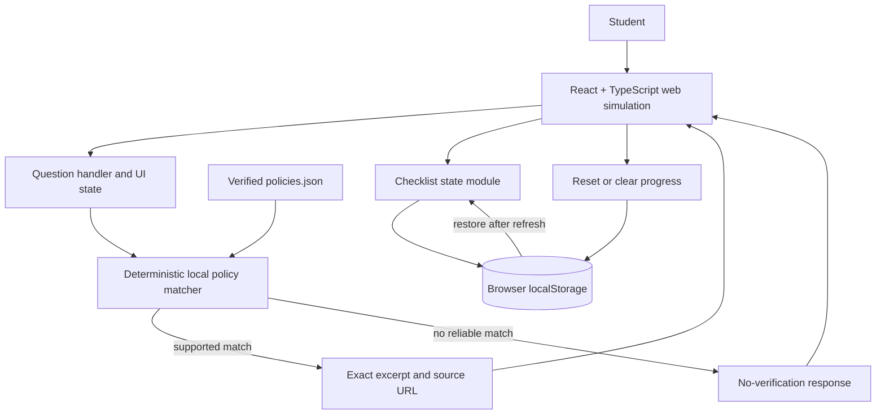
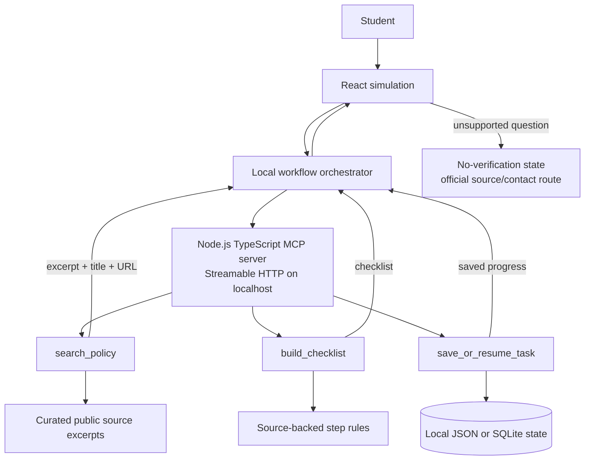

# CourseFlow — Tech Stack and System Architecture

**Purpose:** Implementation guide for Antigravity  
**Project:** CourseFlow — Campus Action Guide  
**Architecture target:** Local-first Alexa+-style web simulation  
**Prepared:** October 23, 2026  

## 1. Recommendation in one minute

Build the first version as a **single local React + TypeScript web app** using Vite, one curated JSON file, deterministic keyword matching, and browser `localStorage` for checklist progress. Keep all core behavior on the laptop. Do not add a backend, database, MCP server, paid API, external LLM, login, or cloud hosting to the MVP.

The source research explored a deeper architecture with a React simulation, workflow orchestrator, Node.js/TypeScript MCP server, three tools (`search_policy`, `build_checklist`, and `save_or_resume_task`), curated public source data, and local JSON or SQLite state. That design remains a valid **optional extension**. The hackathon’s web-simulation route does not require an MCP server; adding it now would increase setup and test risk without being required for this entry path. [1] [2]

## 2. Local/offline operating model

- **At runtime:** Once the project dependencies and policy file exist on the laptop, the app can run locally without calling external services. The policy data, matching logic, checklist, state, CSS, and any fonts should be local.
- **Initial setup:** Creating a Vite app and running `npm install` normally needs internet unless Node/npm and the required packages are already installed or cached. Save `package-lock.json` so future installs are reproducible.
- **Antigravity:** The project files can live on the laptop. Whether Antigravity’s AI/code-generation features work without internet depends on the application’s own model/service configuration; the app itself does not need a cloud AI service.
- **Policy source:** Obtain and verify one public official source before going offline; save the exact excerpt, source title, URL, and check date in the project data.
- **Fonts:** Avoid remote font imports for offline reliability. If local licensed font files are unavailable, use system fallbacks for Syne, Instrument Serif, and JetBrains Mono.

## 3. MVP stack

| Layer | Recommendation | Why it fits |
|---|---|---|
| Language | TypeScript | Safer data shapes for policy entries and checklist state. |
| UI | React | Small interactive question, result, and checklist flow. |
| Build/dev server | Vite | Fast local development and static production build. |
| Styling | Plain CSS or CSS Modules | No additional UI framework required; straightforward offline bundle. |
| Source data | Local JSON (`src/data/policies.json`) | Easy to inspect, edit, cite, and version-control. |
| Search | Deterministic keyword matcher in TypeScript | Transparent, testable, no API key, model, or network call. |
| Checklist state | Browser `localStorage` | Saves checked items between refreshes on the same browser profile. |
| Backend/database | None in MVP | No server state is needed for one local-user prototype. |
| Testing | Manual acceptance checks; add Vitest only if time allows | Prioritize end-to-end behavior before introducing test dependencies. |
| Deployment | None during local build; optional static hosting after completion | Local demo works without a hosted service. |

### Design system

Use the existing creator design direction: `#0a0a08` background, amber primary action, restrained teal and purple accents, Syne headings, Instrument Serif for a small editorial accent, and JetBrains Mono for labels/metadata. Maintain strong contrast and visible keyboard focus. For offline operation, use bundled/licensed font files or system fallbacks instead of relying on Google Fonts at runtime.

## 4. MVP components and responsibilities

### 4.1 React UI (`src/`)

- **QuestionPanel:** text input, submit action, and source-backed sample prompts.
- **EvidencePanel:** institution, document title, last-checked date, exact source excerpt, and official link.
- **ChecklistPanel:** source-backed steps, checkboxes, saved-state indicator, and reset action.
- **DisclosureBanner:** “Alexa+-style simulation · Not connected to Alexa+” and “Prototype · Not an official college service.”
- **StatusMessage:** matching, empty, unsupported/no-match, and error states.

### 4.2 Policy data (`src/data/policies.json`)

Store one verified institutional procedure. Each source record should include its institution, official document title, source URL, last-checked date, match keywords, sample questions, exact excerpt, and prewritten supported steps. Do not place example policy language or placeholder URLs in the final demo.

### 4.3 Local matcher (`src/lib/policySearch.ts`)

Normalize case and punctuation, compare the query with configured keywords, and return a match only when a clear threshold is met. For one procedure, fixed sample prompts plus simple keyword overlap are sufficient. If the score is low, return a typed no-match result. Do not invent an answer from general model knowledge.

### 4.4 Checklist storage (`src/lib/checklistStorage.ts`)

Save only the selected policy ID and checked step IDs in `localStorage`. Include load, save, and clear/reset functions. Avoid saving full free-text query history.

### 4.5 Runtime and build

Vite serves the app on localhost during development and emits static files to `dist/` for a later static deployment if desired. No API server is needed for the MVP. `npm run dev` is the local development command; `npm run build` validates the production bundle.

## 5. MVP Mermaid architecture

This is the recommended architecture for the build being done now: all application behavior stays in the browser, and the only data is the locally curated source file and locally stored checklist state.



### Request/data flow

1. A student submits a question in the React interface.
2. The question handler normalizes the text and calls the local matcher.
3. The matcher reads the local curated policy entries; it makes no network request.
4. A strong match returns the configured source excerpt, title, URL, and checklist steps.
5. The interface renders the evidence and lets the student check steps.
6. Checklist state is written to localStorage and restored on the next load.
7. A weak or missing match returns the no-verification message. It does not show an unsupported policy or fabricate a contact.

## 6. Optional research-report MCP extension (not MVP)

If the local simulation is complete and working, a later version can add a small local Node.js + TypeScript MCP server. The research architecture separates policy search, checklist creation, and save/resume into tools. The event’s MCP path specifies MCP 2025-11-25 or later and Streamable HTTP; confirm the current official rules and SDK compatibility at implementation time. This optional server would power the project’s own simulation unless actual Alexa+ preview access is separately available; do not call it a live Alexa+ integration. [1] [3] [4]



**Extension guardrails:** Do not implement MCP until the core web simulation, citation, checklist persistence, no-match behavior, demo, and submission materials are ready. Do not expose a local server to the public internet just to imply Alexa+ access. If you later add the MCP server, test tool inputs, output citations, refusal behavior, persistence, and transport locally.

## 7. Security and privacy design

- Use public official documents only; retain the title, URL, and date for attribution.
- No accounts, student IDs, grades, attendance, private messages, microphone, camera, or analytics.
- Keep user input in memory; persist only checklist state needed to resume.
- Include a reset action that deletes local checklist state.
- Keep all policy content static and inspectable; do not render untrusted HTML as executable markup.
- Do not include API keys or secrets in source control; the MVP needs none.
- Avoid remote fonts, images, analytics, and runtime CDN dependencies if the app must work offline.

## 8. Local setup and verification

From the chosen project folder (initial scaffold generally needs an internet connection unless dependencies are cached):

```bash
npm create vite@latest courseflow -- --template react-ts
cd courseflow
npm install
npm run dev
```

Open the folder in Antigravity and attach the PRD plus this architecture document. Ask Antigravity to implement **the MVP only** and to treat the MCP extension as out of scope. After development, run:

```bash
npm run build
```

Before calling it complete, test:

1. One sample query matches the correct source.
2. The exact source excerpt, title, URL, and date are visible.
3. Only configured source-backed steps appear.
4. Checklist progress remains after refresh.
5. Reset clears saved progress.
6. An unrelated question returns the no-verification message and no invented policy.
7. The app still works with the laptop’s internet disconnected after dependencies are installed.

## 9. Later GitHub upload workflow

Keep the project in one folder on your laptop during development. When it is complete and you are ready to publish it, review the source and remove private files, local environment files, build caches, and `node_modules`. Add an appropriate license if the repository will be public. Then, once connected to the internet, create the GitHub repository and push the project using the GitHub app/website or the approved CLI workflow. Do not upload institution-only or student-private documents. Include source attribution for every policy excerpt.

## 10. References

[1] [Official Amazon Developer Hackathon rules](https://amazonappdev2026.devpost.com/rules)  
[2] [Official hackathon FAQ](https://amazonappdev2026.devpost.com/details/faqs)  
[3] [Official hackathon resource hub](https://amazonappdev2026.devpost.com/resources)  
[4] [Amazon Alexa+ MCP Toolkit QuickStart](https://developer.amazon.com/docs/alexaplus/add-ons/mcp-toolkit-quickstart.html)  
[5] [W3C cognitive accessibility guidance for voice systems](https://www.w3.org/TR/coga-voice/)

## Repository structure for later GitHub upload

Start with the root-level Vite app; do not create a complex monorepo for the MVP. Keep the optional MCP server out of the build until the local simulation is complete.

```text
courseflow/
├── public/
│   └── favicon.svg
├── src/
│   ├── components/
│   │   ├── DisclosureBanner.tsx
│   │   ├── QuestionPanel.tsx
│   │   ├── EvidencePanel.tsx
│   │   ├── ChecklistPanel.tsx
│   │   └── StatusMessage.tsx
│   ├── data/
│   │   └── policies.json          # verified public source excerpts only
│   ├── lib/
│   │   ├── policySearch.ts        # deterministic local matching
│   │   └── checklistStorage.ts    # localStorage load/save/reset
│   ├── types/
│   │   └── policy.ts
│   ├── App.tsx
│   ├── App.css
│   └── main.tsx
├── tests/
│   ├── policySearch.test.ts       # optional if test runner is added
│   └── acceptance-checklist.md
├── docs/
│   ├── CourseFlow_PRD.md
│   └── CourseFlow_Tech_Stack_and_System_Architecture.md
├── future/                        # optional; create only if extending later
│   └── mcp-server/
│       └── README.md              # planned MCP extension, not part of MVP
├── .gitignore
├── LICENSE                        # include if public; choose a license deliberately
├── README.md
├── index.html
├── package.json
├── package-lock.json
├── tsconfig.json
└── vite.config.ts
```
