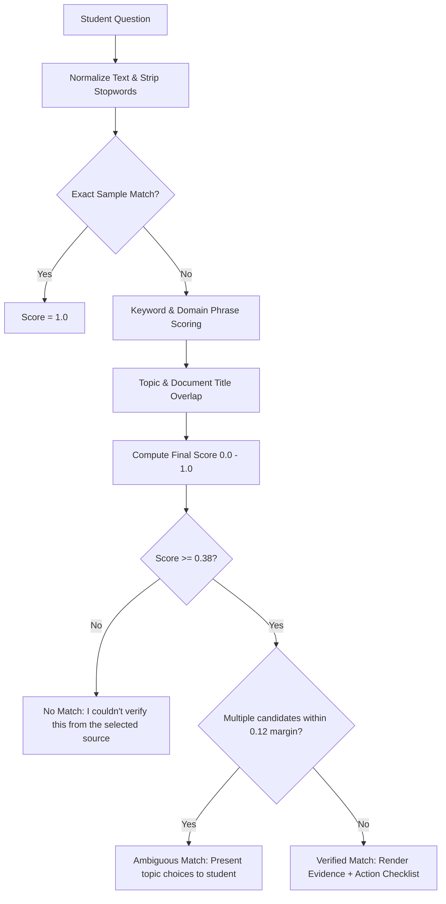

# CourseFlow — Campus Action Guide

> **An Alexa+-style local-first simulated assistant that turns official campus instructions into verified, source-backed action checklists.**

[](https://www.typescriptlang.org/)
[](https://react.dev/)
[](https://vitejs.dev/)
[]()

---

## 1. What is CourseFlow?

**CourseFlow** is a web-based, Alexa+-style assistant simulation designed to help students navigate institutional procedures. Routine campus processes—such as course enrollment, add/drop deadlines, and grading options—are frequently buried in dense, multi-page university registrar guidelines.

Students often struggle to translate these official texts into concrete next steps. CourseFlow solves this by matching student questions against verified, locally stored institutional policy data and immediately presenting two coordinated views:
1. **The Exact Source Evidence:** The cited institution, document title, exact verbatim excerpt, verified last-checked date, and official source URL.
2. **An Actionable Checklist:** Step-by-step procedural tasks backed directly by the cited excerpt, with browser `localStorage` persistence so students can track, resume, or reset their progress.

---

## 2. Product Identity & Honest Disclosures

### What CourseFlow IS:
* A **web application prototype** built with React, TypeScript, and Vite.
* A **simulated Alexa+-style experience** running entirely in the browser.
* A **local-first, deterministic, source-grounded procedural guide**.

### What CourseFlow IS NOT:
* **NOT a live Alexa+ integration** or official Alexa Skill (it does not require Amazon hardware, live Alexa+ preview accounts, or remote cloud services).
* **NOT an official university service** (it is an independent educational technology hackathon prototype).
* **NOT a probabilistic AI chatbot:** It does not use external LLMs, remote APIs, or vector databases, and it **never hallucinates or fabricates policy details, deadlines, contacts, or fees**.

---

## 3. Technology Stack & Architecture

CourseFlow is engineered to be lightweight, fast, accessible, and completely runnable offline after package installation:

| Layer | Technology | Rationale |
|:---|:---|:---|
| **Frontend Framework** | React 19 + TypeScript 5.7 | Strict type safety for policy records, match scoring, and checklist state. |
| **Build & Dev Tool** | Vite 6 | Sub-second HMR development server and optimized static production bundle. |
| **Styling & Design System** | Pure CSS & CSS Custom Properties | No heavy UI frameworks; follows the CourseFlow dark luxury editorial design tokens. |
| **Policy Data** | Local JSON (`src/data/policies.json`) | Transparent, auditable, version-controlled official registrar excerpts. |
| **Search Engine** | Deterministic Keyword & Phrase Matcher (`src/lib/policySearch.ts`) | Fast, local keyword overlap, sample question matching, and ambiguity margin analysis. |
| **Persistence** | Browser `localStorage` (`src/lib/checklistStorage.ts`) | Zero-cloud, client-side progress persistence with corruption recovery. |
| **Testing** | Node.js Test Runner + `tsx` | 12 automated unit and integration tests covering scoring, refusal, and persistence. |

---

## 4. UI/UX Design System

CourseFlow implements the visual direction defined in the attached **CourseFlow UI/UX Design System**:

* **Palette:**
  * **Canvas:** `#0A0A08` (Darkest charcoal base)
  * **Surface:** `#171715` (Primary panel container)
  * **Raised Surface:** `#222222` (Card and input surface)
  * **Border:** `#343434` (Subtle structural borders)
  * **Primary Text:** `#F4F1EB` (Warm Ivory)
  * **Secondary Text:** `#B7B5B0` (Readable supporting text)
  * **Brand Primary:** `#0D4C3C` (Dark Emerald for primary action buttons)
  * **Hover State:** `#12624C`
  * **Progress & Success:** `#7AA05A` (Moss Green for completion status)
  * **Accent:** `#A55BFF` (Electric Violet for focus rings and subtle brand accents)
  * **Warning / Refusal:** `#F0C36A` / `#FF8585`
* **Typography:**
  * **Headings:** `Syne`, sans-serif (semibold and bold)
  * **Body Copy:** `Inter`, sans-serif
  * **Metadata:** `JetBrains Mono`, monospace
* **Layout:**
  * Desktop (≥1024px): 1120px max-width container, prominent composer, 2-column results grid (Evidence on left, Checklist on right).
  * Mobile (<768px): Single-column reflow, minimum 44×44px touch targets, zero horizontal scrolling.
  * Accessibility: Full keyboard navigation, visible high-contrast focus rings (`outline: 2px solid #A55BFF; outline-offset: 3px`), and `prefers-reduced-motion` compliance.

---

## 5. How Deterministic Matching Works

CourseFlow intentionally avoids unpredictable LLM generation. Instead, `src/lib/policySearch.ts` uses transparent, reproducible scoring:



1. **Input Normalization:** Strips punctuation, normalizes case, and filters common English stopwords.
2. **Sample Question Matching:** Direct exact or near-match with configured sample questions awards high confidence (0.95–1.0).
3. **Domain Phrase Weighting:** Multi-word phrases (e.g. `"phase 1"`, `"drop class"`, `"grading option"`) receive targeted weight bonuses.
4. **Keyword & Title Coverage:** Evaluates significant token overlap against policy keywords, topics, and titles.
5. **Threshold & Ambiguity Enforcement:**
   * Acceptance threshold: `0.38`. Any score below this triggers a safe refusal.
   * Ambiguity margin: If the difference between the top two candidates is $\le 0.12$, CourseFlow presents a choice between topics rather than silently guessing.

---

## 6. Official Institutional Data Source

The current MVP is grounded in official, publicly available documents from the **University of California, Berkeley Office of the Registrar**:

* **Document Title:** *Enrollment: How to Enroll in Classes and Enrollment Periods*
* **Official URL:** [https://registrar.berkeley.edu/enrollment](https://registrar.berkeley.edu/enrollment)
* **Verified Check Date:** `October 23, 2026`
* **Department Authority:** Office of the University Registrar
* **Storage Location:** [`src/data/policies.json`](file:///Users/shakeebkhan/Collages/Competetions%20/Amazon%20Developer%20Hackathon%20/src/data/policies.json)

---

## 7. Getting Started & Run Instructions

### Prerequisites
* **Node.js:** v18.0.0 or later (Tested on Node v24.18.0)
* **npm:** v9.0.0 or later (Tested on npm 11.16.0)

### 1. Install Dependencies
```bash
npm install
```

### 2. Start the Local Development Server
```bash
npm run dev
```
Open your browser to [http://localhost:5173](http://localhost:5173).

### 3. Run the Automated Test Suite
```bash
npm test
```
Runs 12 unit and integration tests verifying matching, refusal logic, and persistence.

### 4. Build for Production
```bash
npm run build
```
Compiles TypeScript and emits an optimized static web bundle into the `dist/` directory.

### 5. Preview the Production Build
```bash
npm run preview
```

---

## 8. Verified End-to-End Test Scenarios

| Scenario | User Action | Expected System Behavior |
|:---|:---|:---|
| **Sample Query** | Click *"How do I enroll in classes for Phase 1 and Phase 2 at UC Berkeley?"* | Instantly displays verified match banner, exact Berkeley excerpt, source link, and 6-step checklist. |
| **Progress Persistence** | Check steps 1, 2, and 3, then refresh browser | Progress indicator restores to `"3 of 6 steps completed (50%)"` from `localStorage`. |
| **Step Reset** | Click *"Reset checklist"* and confirm with *"Yes, reset"* | Checklist resets to `"0 of 6 steps completed (0%)"`, clearing only the active policy's state. |
| **Unsupported Query** | Ask *"How do I buy a campus parking permit?"* | Safe refusal: displays *"I couldn’t verify this from the selected source"* with suggested verified queries. |
| **Ambiguous Query** | Ask *"classes at Berkeley"* | Ambiguity handler displays candidate cards for *Course Enrollment* and *Schedule Adjustments*. |

---

## 9. Intentionally Excluded from MVP

In accordance with Section 6 of the PRD and Technical Architecture:
* **No live Alexa+ or Amazon cloud connection** (the entrant uses local tools to simulate an Alexa+ experience).
* **No MCP server in the MVP core** (architected as a potential future extension).
* **No external LLM inference, paid APIs, or remote databases**.
* **No student login, authentication, student ID tracking, or grades**.
* **No multi-campus expansion** beyond verified records.

---

## 10. License

MIT License. Designed and built for the Amazon Developer Hackathon 2026.
